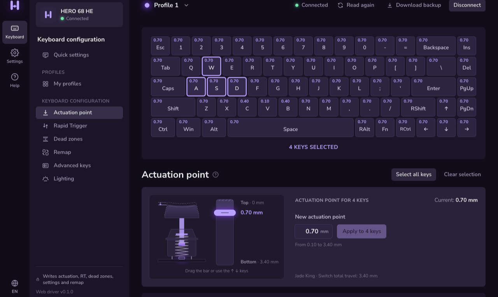
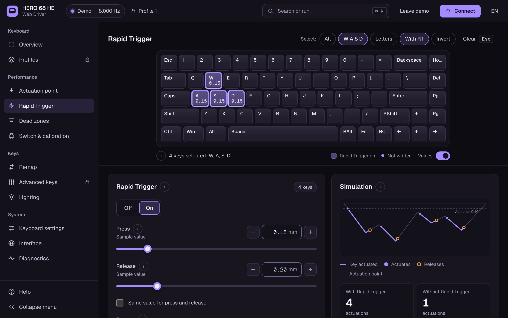
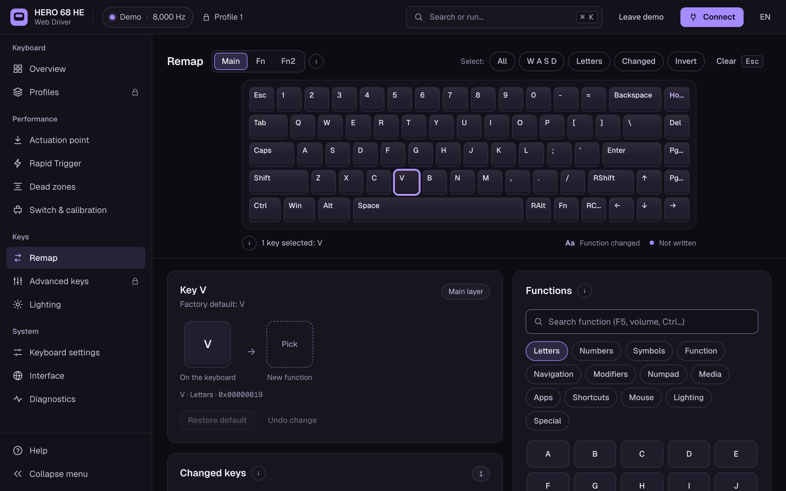

<p align="center">
  <a href="https://b9rnardo.github.io/aula-hero68-webdriver/"></a>
</p>

<h1 align="center">HERO 68 HE Web Driver</h1>

<p align="center">
  Unofficial web configurator for the <b>AULA HERO 68 HE</b> magnetic (Hall effect) keyboard.<br />
  Runs in your browser over WebHID. Nothing to install.
</p>

<p align="center">
  <a href="https://b9rnardo.github.io/aula-hero68-webdriver/"><b>Open the driver</b></a> ·
  <a href="#features">Features</a> ·
  <a href="#getting-started">Getting started</a> ·
  <a href="#development">Development</a> ·
  <a href="README.pt-BR.md">Leia em português 🇧🇷</a>
</p>

<p align="center">
  <a href="https://b9rnardo.github.io/aula-hero68-webdriver/"></a>
  <a href="https://github.com/b9rnardo/aula-hero68-webdriver/actions/workflows/deploy.yml"></a>
  
  <a href="LICENSE"></a>
</p>

<p align="center">
  
</p>

## Features

| | Read | Write |
|---|:---:|:---:|
| **Actuation point** per key, from 0.10 mm to the full switch travel | ✅ | ✅ |
| **Rapid Trigger** with separate press and release sensitivity, in 0.01 mm steps | ✅ | ✅ |
| **Dead zones** at the top and bottom of the travel | ✅ | ✅ |
| **Switch type** per key, from the models the keyboard accepts | ✅ | ✅ |
| **Live travel**: how far each key is down, about 20 times a second | ✅ | – |
| **Calibration** | – | planned |
| **Key remapping** on the main, Fn and Fn2 layers | ✅ | ✅ |
| **Polling rate** from 125 to 8000 Hz | ✅ | ✅ |
| **Win lock, Mac mode, debounce and adaptive calibration** | ✅ | ✅ |
| **Lighting**: main light, side light and per-key colors | ✅ | planned |
| **Profiles** | ✅ | planned |
| **Advanced keys**: DKS, MT, TGL, SOCD, MPT and END | ✅ | planned |
| **Sleep timer** | ✅ | – |

And also:

- **Wootility-style interface**: keyboard at the top, settings cards below. Click or drag across keys to select several, and the cards show just their values.
- **Charts that simulate the key travel** for Rapid Trigger and dead zones, so you can see what a value does before applying it.
- **Every write is checked**: after applying, the app reads the keyboard again and warns you if something didn't stick.
- **JSON backup** of the whole configuration, which you can open later without the keyboard.
- **Demo mode** to explore the interface without a keyboard.
- **English and Brazilian Portuguese**, plus a HID packet log for debugging.

<table>
  <tr>
    <td width="50%" valign="top"></td>
    <td width="50%" valign="top"></td>
  </tr>
  <tr>
    <td align="center"><sub>Rapid Trigger with a simulated key press</sub></td>
    <td align="center"><sub>Remapping a key from the function library</sub></td>
  </tr>
</table>

## Getting started

1. Open **[b9rnardo.github.io/aula-hero68-webdriver](https://b9rnardo.github.io/aula-hero68-webdriver/)** in **Chrome or Edge** on a computer.
2. Plug the keyboard in with the **USB cable**.
3. Click **Connect keyboard** and pick **HERO 68 HE** from the list.
4. Select keys, change a value and click **Apply**.

Next time, the driver reconnects on its own to a keyboard you already allowed.

> [!TIP]
> Download a backup first (**My profiles → Download backup**) so you have a record of your original settings.

<details>
<summary><b>Troubleshooting</b></summary>

- **The keyboard isn't in the list.** Use Chrome or Edge on desktop (Firefox, Safari and mobile browsers don't support WebHID), connect with the cable and close the official AULA driver if it's open in another tab.
- **The keyboard disconnects when I change the polling rate.** That's expected: the keyboard restarts its USB connection to apply the new rate. The driver waits for it and reads it again.
- **Linux: the keyboard shows up but won't connect.** Your user may need access to the HID device. Create `/etc/udev/rules.d/99-aula-hero68.rules` with the line below, then run `sudo udevadm control --reload-rules && sudo udevadm trigger` and plug the keyboard in again.

  ```
  SUBSYSTEM=="hidraw", ATTRS{idVendor}=="372e", ATTRS{idProduct}=="103e", MODE="0660", TAG+="uaccess"
  ```

</details>

## Safety

This is an independent project and isn't affiliated with AULA. The protocol was worked out by studying the official web driver.

Each kind of write was tested on a real keyboard first: change a value, read everything back, check that only that value changed, then restore the original. Even so, **use it at your own risk**. If something goes wrong, hold **Fn + Space for 5 seconds** to restore the factory defaults.

## Roadmap

- [x] Read the full configuration and export a JSON backup
- [x] Write actuation, Rapid Trigger and dead zones
- [x] Write general settings and key remapping
- [ ] Write lighting
- [ ] Write profiles
- [ ] Write advanced keys and macros

## Development

Built with React 19, TypeScript, Vite, Tailwind CSS 4, Zustand and Vitest.

```bash
npm install
npm run dev      # http://localhost:5173
npm test         # protocol and store tests
npm run build    # static site in dist/
```

WebHID only works on HTTPS or `localhost`.

| Folder | Contents |
|---|---|
| `src/hid/` | protocol (frames, checksum), WebHID transport, keyboard API, full read |
| `src/data/` | 68-key layout, keycodes, switches, lighting effects |
| `src/store/` | app state (Zustand) |
| `src/i18n/` | English and Portuguese strings |
| `src/pages/`, `src/components/` | interface (React + Tailwind) |
| `docs/` | analysis of the official driver and extracted data (in Portuguese) |

<details>
<summary><b>Protocol at a glance</b></summary>

The keyboard (USB `372E:103E`) takes configuration on HID interface 2, report ID 9. Every message is a 63-byte frame:

```
[command, sub, type, total, index, length, data × 56, checksum]
```

Multi-byte values are big-endian. Read commands are the write command with the high bit set (`0x13` writes actuation, `0x93` reads it). The keyboard echoes each write, and there is no separate save command.

| Command | What it writes |
|---|---|
| `0x03` | keymap; the sub byte is the layer |
| `0x04` | general settings, one byte each |
| `0x13` | actuation point |
| `0x16` | dead zones |
| `0x19` | Rapid Trigger |

The full analysis, with every validated frame, is in [`docs/analise.md`](docs/analise.md) (Portuguese).

</details>

### Deploying

`npm run build` creates a static site with relative paths, so it works on any static host with HTTPS. In this repository, [`.github/workflows/deploy.yml`](.github/workflows/deploy.yml) runs the tests, builds and publishes to GitHub Pages on every push to `master`. To use it in a fork, set **Settings → Pages → Source** to **GitHub Actions**.

## License

Copyright (C) 2026 b9rnardo. Released under the [GNU General Public License v3.0 or later](LICENSE).

AULA and HERO 68 HE are names of their respective owners.
