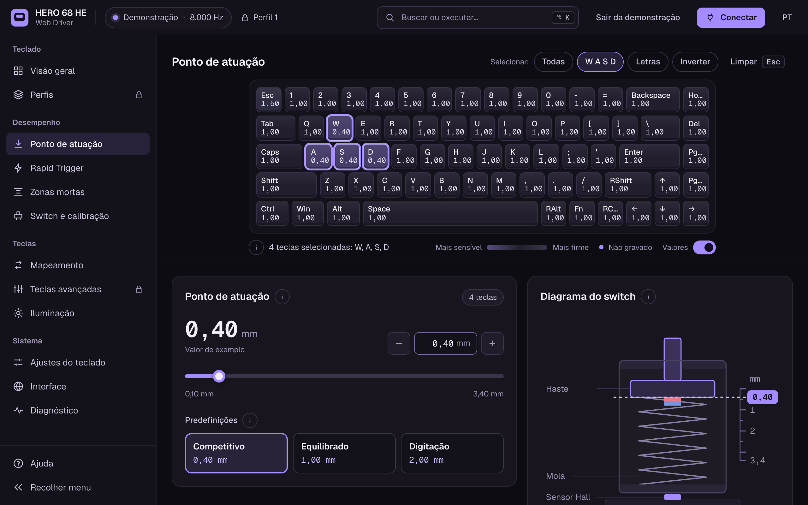
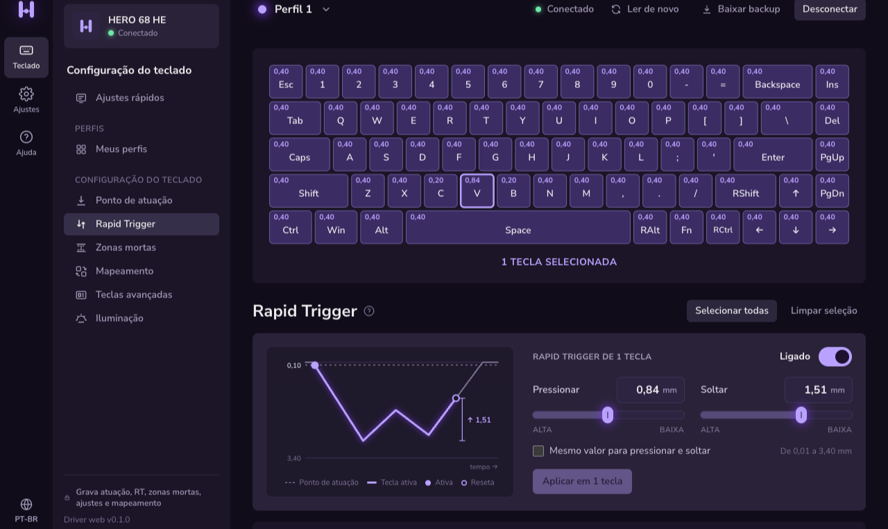
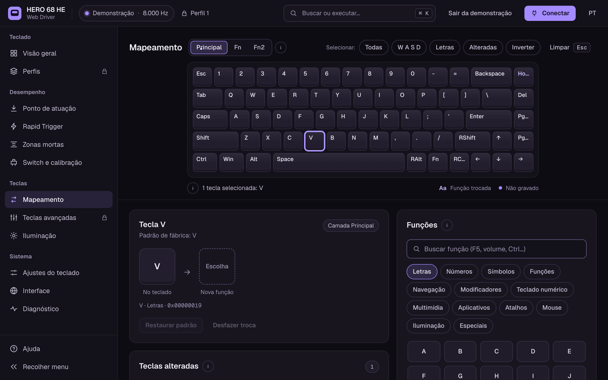

<p align="center">
  <a href="https://b9rnardo.github.io/aula-hero68-webdriver/"></a>
</p>

<h1 align="center">HERO 68 HE Web Driver</h1>

<p align="center">
  Configurador web não oficial para o teclado magnético (Hall effect) <b>AULA HERO 68 HE</b>.<br />
  Roda no navegador via WebHID. Não precisa instalar nada.
</p>

<p align="center">
  <a href="https://b9rnardo.github.io/aula-hero68-webdriver/"><b>Abrir o driver</b></a> ·
  <a href="#recursos">Recursos</a> ·
  <a href="#como-usar">Como usar</a> ·
  <a href="#desenvolvimento">Desenvolvimento</a> ·
  <a href="README.md">Read in English 🇺🇸</a>
</p>

<p align="center">
  <a href="https://b9rnardo.github.io/aula-hero68-webdriver/"></a>
  <a href="https://github.com/b9rnardo/aula-hero68-webdriver/actions/workflows/deploy.yml"></a>
  
  <a href="LICENSE"></a>
</p>

<p align="center">
  
</p>

## Recursos

| | Lê | Grava |
|---|:---:|:---:|
| **Ponto de atuação** por tecla, de 0,10 mm até o curso todo do switch | ✅ | ✅ |
| **Rapid Trigger** com sensibilidade de pressionar e soltar separadas, em passos de 0,01 mm | ✅ | ✅ |
| **Zonas mortas** no topo e no fundo do curso | ✅ | ✅ |
| **Tipo de switch** por tecla, entre os modelos que o teclado aceita | ✅ | ✅ |
| **Curso ao vivo**: quanto cada tecla desceu, cerca de 20 vezes por segundo | ✅ | – |
| **Calibração** | – | em breve |
| **Mapeamento de teclas** nas camadas principal, Fn e Fn2 | ✅ | ✅ |
| **Polling rate** de 125 a 8000 Hz | ✅ | ✅ |
| **Trava Win, modo Mac, debounce e calibração adaptativa** | ✅ | ✅ |
| **Iluminação**: luz principal, luz lateral e cores por tecla | ✅ | em breve |
| **Perfis** | ✅ | em breve |
| **Teclas avançadas**: DKS, MT, TGL, SOCD, MPT e END | ✅ | em breve |
| **Tempo de suspensão** | ✅ | – |

E mais:

- **Interface no estilo do Wootility**: teclado no topo e cartões de ajuste embaixo. Clique ou arraste sobre as teclas para selecionar várias, e os cartões mostram só os valores delas.
- **Gráficos que simulam o curso da tecla** no Rapid Trigger e nas zonas mortas, para ver o efeito de um valor antes de aplicar.
- **Toda gravação é conferida**: depois de aplicar, o app lê o teclado de novo e avisa se algo não ficou gravado.
- **Backup em JSON** da configuração inteira, que dá para abrir depois sem o teclado.
- **Modo demonstração** para conhecer a interface sem teclado.
- **Português e inglês**, além de um log dos pacotes HID para depuração.

<table>
  <tr>
    <td width="50%" valign="top"></td>
    <td width="50%" valign="top"></td>
  </tr>
  <tr>
    <td align="center"><sub>Rapid Trigger com um toque simulado</sub></td>
    <td align="center"><sub>Trocando a função de uma tecla pela biblioteca</sub></td>
  </tr>
</table>

## Como usar

1. Abra **[b9rnardo.github.io/aula-hero68-webdriver](https://b9rnardo.github.io/aula-hero68-webdriver/)** no **Chrome ou no Edge**, num computador.
2. Conecte o teclado pelo **cabo USB**.
3. Clique em **Conectar teclado** e escolha **HERO 68 HE** na lista.
4. Selecione as teclas, mude o valor e clique em **Aplicar**.

Nas próximas vezes, o driver reconecta sozinho a um teclado que você já autorizou.

> [!TIP]
> Baixe um backup antes (**Meus perfis → Baixar backup**) para ter registrado como estava a sua configuração.

<details>
<summary><b>Problemas comuns</b></summary>

- **O teclado não aparece na lista.** Use o Chrome ou o Edge no computador (Firefox, Safari e navegadores de celular não têm WebHID), conecte pelo cabo e feche o driver oficial da AULA se ele estiver aberto em outra aba.
- **O teclado desconecta quando troco o polling rate.** É normal: o teclado reinicia a conexão USB para aplicar a nova taxa. O driver espera ele voltar e lê tudo de novo.
- **Linux: o teclado aparece, mas não conecta.** Seu usuário pode precisar de acesso ao dispositivo HID. Crie o arquivo `/etc/udev/rules.d/99-aula-hero68.rules` com a linha abaixo, rode `sudo udevadm control --reload-rules && sudo udevadm trigger` e conecte o teclado de novo.

  ```
  SUBSYSTEM=="hidraw", ATTRS{idVendor}=="372e", ATTRS{idProduct}=="103e", MODE="0660", TAG+="uaccess"
  ```

</details>

## Segurança

Este é um projeto independente, sem ligação com a AULA. O protocolo foi entendido analisando o driver web oficial.

Cada tipo de gravação foi testado num teclado real antes de ser liberado: muda um valor, relê tudo, confere que só aquele valor mudou e restaura o original. Mesmo assim, **use por sua conta e risco**. Se algo der errado, segure **Fn + Espaço por 5 segundos** para voltar ao padrão de fábrica.

## Próximos passos

- [x] Ler a configuração completa e exportar backup em JSON
- [x] Gravar atuação, Rapid Trigger e zonas mortas
- [x] Gravar ajustes gerais e mapeamento de teclas
- [ ] Gravar iluminação
- [ ] Gravar perfis
- [ ] Gravar teclas avançadas e macros

## Desenvolvimento

Feito com React 19, TypeScript, Vite, Tailwind CSS 4, Zustand e Vitest.

```bash
npm install
npm run dev      # http://localhost:5173
npm test         # testes do protocolo e do estado
npm run build    # site estático em dist/
```

O WebHID só funciona em HTTPS ou em `localhost`.

| Pasta | Conteúdo |
|---|---|
| `src/hid/` | protocolo (frames, checksum), transporte WebHID, API do teclado, leitura completa |
| `src/data/` | layout das 68 teclas, keycodes, switches, efeitos de luz |
| `src/store/` | estado do app (Zustand) |
| `src/i18n/` | textos em português e inglês |
| `src/pages/`, `src/components/` | interface (React + Tailwind) |
| `docs/` | análise do driver oficial e dados extraídos |

<details>
<summary><b>Protocolo em resumo</b></summary>

O teclado (USB `372E:103E`) recebe a configuração na interface HID 2, report ID 9. Toda mensagem é um frame de 63 bytes:

```
[comando, sub, tipo, total, índice, tamanho, dados × 56, checksum]
```

Valores de vários bytes são big-endian. O comando de leitura é o de escrita com o bit mais alto ligado (`0x13` grava a atuação, `0x93` lê). O teclado ecoa cada gravação, e não existe comando separado para salvar.

| Comando | O que grava |
|---|---|
| `0x03` | mapeamento; o byte sub é a camada |
| `0x04` | ajustes gerais, um byte cada |
| `0x13` | ponto de atuação |
| `0x16` | zonas mortas |
| `0x19` | Rapid Trigger |

A análise completa, com cada frame validado, está em [`docs/analise.md`](docs/analise.md).

</details>

### Publicar

O `npm run build` gera um site estático com caminhos relativos, que funciona em qualquer hospedagem estática com HTTPS. Neste repositório, o [`.github/workflows/deploy.yml`](.github/workflows/deploy.yml) roda os testes, gera o build e publica no GitHub Pages a cada push no `master`. Para usar num fork, ative **Settings → Pages → Source: GitHub Actions**.

## Licença

Copyright (C) 2026 b9rnardo. Distribuído sob a [GNU General Public License v3.0 ou posterior](LICENSE).

AULA e HERO 68 HE são nomes dos seus respectivos donos.
